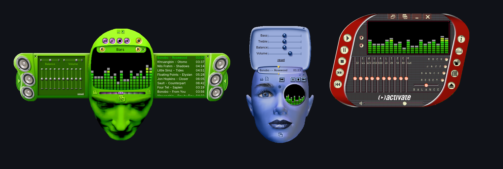

Spotifast 0.17 makes Windows Media Player skins real. Skins now run their own scripts, in a sandbox, so their drawers, intro animations, playlists, equalizers and extra windows work the way they did in Windows Media Player. Spotify Soloist has a new setup and clearer Settings, and when it stops, Spotifast now stays usable and brings it back by itself.

**Download Spotifast:** [Mac](https://github.com/crmne/spotifast/releases/download/v0.17.0/spotifast-v0.17.0-macos-universal.dmg) · [Windows](https://github.com/crmne/spotifast/releases/download/v0.17.0/spotifast-v0.17.0-x86_64-pc-windows-msvc.msi) · [Windows ARM](https://github.com/crmne/spotifast/releases/download/v0.17.0/spotifast-v0.17.0-aarch64-pc-windows-msvc.msi) · [Linux](https://github.com/crmne/spotifast/releases/download/v0.17.0/spotifast-v0.17.0-x86_64-unknown-linux-gnu.tar.gz) · [Linux ARM](https://github.com/crmne/spotifast/releases/download/v0.17.0/spotifast-v0.17.0-aarch64-unknown-linux-gnu.tar.gz) · [Flatpak](https://github.com/crmne/spotifast/releases/download/v0.17.0/spotifast-v0.17.0-x86_64.flatpak) · [AppImage](https://github.com/crmne/spotifast/releases/download/v0.17.0/spotifast-0.17.0-x86_64.AppImage) · [AppImage ARM](https://github.com/crmne/spotifast/releases/download/v0.17.0/spotifast-0.17.0-aarch64.AppImage)

## New

- **Windows Media Player skins run as they were made.** Their scripts run in a sandbox with no access to your files, the network or other programs. Every view works: drawers, shutters, hidden panels, separate windows, and windows shaped like the skin. Playlist panels show your queue, equalizer panels change Spotifast's equalizer, and visualization areas show the same bars or sound wave as Winamp skins. By @crmne and @davorb.
- **More skins, one place to find them.** Settings links to the Internet Archive's [Windows Media Player Skins Collection](https://archive.org/details/windowsmediaplayerskinscollection), and **Open folder** now covers both kinds of skin. By @crmne.
- **A new Soloist setup.** Three clear steps, real download progress, and a pairing step that walks you through the Spotify desktop app, with help if Soloist doesn't appear. By @crmne; thanks @PixelAsh6 and @VatSenator. ([#1137](https://github.com/crmne/spotifast/issues/1137), [#1142](https://github.com/crmne/spotifast/issues/1142))
- **Clearer Soloist Settings.** Status, version, audio quality, Spotify access and turning it off now read as one group. By @crmne.
- **Open a Spotify link from the search bar.** Paste it and press Enter. By @crmne; thanks @zamhedonia. ([#1027](https://github.com/crmne/spotifast/issues/1027))
- **Shift+Q adds the selected songs to the queue, Shift+N plays them next.** By @crmne; thanks @outronobre. ([#1110](https://github.com/crmne/spotifast/issues/1110))
- **Compilations on artist pages,** beside albums and singles. By @crmne; thanks @samu-mi8. ([#1069](https://github.com/crmne/spotifast/issues/1069))
- **Page filters stay on one row,** and scroll when they don't fit. By @crmne.

## Fixed

- **Soloist no longer drops you on its setup page.** If it stops, Spotifast stays open, restarts it and carries on with what was playing. If that doesn't work, a banner offers **Try again** and the built-in player. By @crmne; thanks @garpu-ng and @caeksec. ([#1140](https://github.com/crmne/spotifast/issues/1140), [#1159](https://github.com/crmne/spotifast/issues/1159))
- **A brief audio problem no longer stops Soloist.** Spotifast rebuilds the audio route while Soloist keeps running, and logs what went wrong. By @crmne.
- **A shared song link selects that song** on its album, instead of only opening the album. By @crmne; thanks @boboryan. ([#1117](https://github.com/crmne/spotifast/issues/1117))
- **A song shows as playing only in the playlist it plays from.** By @crmne; thanks @jorisw. ([#1106](https://github.com/crmne/spotifast/issues/1106))
- **A playlist you left no longer lights up again.** By @crmne; thanks @jorisw. ([#1121](https://github.com/crmne/spotifast/issues/1121))
- **The playing playlist is remembered across a restart.** By @crmne; thanks @Altair-Qu-Ten. ([#1013](https://github.com/crmne/spotifast/issues/1013))
- **A restart during autoplay resumes the right song** at its saved position. By @crmne; thanks @ECuteri. ([#856](https://github.com/crmne/spotifast/issues/856))

## Thanks

@davorb, @PixelAsh6, @VatSenator, @garpu-ng, @caeksec, @zamhedonia, @outronobre, @samu-mi8, @boboryan, @jorisw, @Altair-Qu-Ten, @ECuteri, and everyone who reported problems since 0.16.0.

**Full changelog**: https://github.com/crmne/spotifast/compare/v0.16.0...v0.17.0
